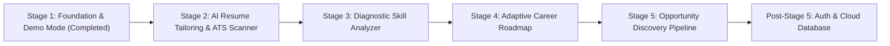

# PathPilot — AI Career & Skill Navigator

> **Stage 1 — Foundation Architecture & Demo Mode MVP**  
> A modular, dark-first career progression platform built with Next.js (App Router), TypeScript, and Tailwind CSS.

---

## ⚡ Quick Start (Zero Setup Required)

PathPilot Stage 1 is engineered for **instant, frictionless local execution**. Anyone on the development team can clone the repository, run the application immediately, and test with the pre-populated demo workspace.

### Prerequisites
- Node.js `v18+` or `v20+` (Tested on Node `v24`)
- npm / yarn / pnpm

### Installation & Run

```bash
# 1. Install dependencies
npm install

# 2. Launch the development server
npm run dev
```

Open [http://localhost:3000](http://localhost:3000) in your browser to immediately access the **PathPilot Demo Workspace**.

---

## 🔒 Mandatory Architecture Decision: Zero-Auth Stage 1

**Authentication is intentionally postponed until AFTER Stage 5.**

This build deliberately **does NOT implement**:
- ❌ Signup or login screens
- ❌ Passwords or password-reset flows
- ❌ Supabase Auth or third-party OAuth
- ❌ Authentication middleware blocking routes
- ❌ Mandatory cloud database credentials or API keys

### Why This Decision Was Made
1. **Frictionless Developer Experience:** Any engineer, designer, or stakeholder can test all core platform features without provisioning cloud database instances or acquiring secrets.
2. **Clean Domain Modeling First:** The platform architecture focuses on profile models, skill graphs, resume tailoring, and roadmap pipelines without auth overhead.
3. **Decoupled Repository Pattern:** All data access is mediated through TypeScript repository interfaces (`IProfileRepository`, `ISkillRepository`, etc.). Swapping from browser local storage to Supabase/PostgreSQL after Stage 5 requires zero alterations to UI components.

---

## 💾 Data Storage Architecture & Warning

### How Data is Stored
- PathPilot uses a typed storage adapter located in [`lib/storage/storage-adapter.ts`](lib/storage/storage-adapter.ts).
- All keys are namespaced and versioned (`pathpilot_mvp_v1:*`) to support future schema migrations.
- Data access is **SSR-safe** (`typeof window !== "undefined"` checks guarantee no hydration mismatches or server-side crashes).
- Malformed JSON or storage quota exceptions are safely trapped with fallback defaults.
- On first launch, the app seeds an initial fictional candidate profile (**Alex Morgan**, Senior Full-Stack Engineer aiming for **Staff AI Solutions Architect**). User edits persist locally and are **never overwritten on page reloads** unless a deliberate reset is triggered.

### ⚠️ Development Storage Notice
> **IMPORTANT:** Browser storage (`localStorage`) is used strictly for development, design verification, and stage prototyping. It is **NOT** secure production storage. Do not store sensitive or real-world private candidate information in this build.

---

## 🧭 Application Navigation & Routes

| Route | View | Description | Stage Status |
|---|---|---|---|
| `/` or `/dashboard` | **Dashboard** | Candidate welcome, completion meter, target role readiness, interactive roadmap preview, recommended next steps, and activity log. | **Stage 1 (Complete)** |
| `/profile` | **My Profile** | View & edit candidate information, target industry, bio, and social proof links. Persists to local storage. | **Stage 1 (Complete)** |
| `/resume` | **Resume Builder** | Saved resume drafts manager, ATS optimization scores, section completion meters, and Stage 2 engine preview. | **Stage 2 Preview** |
| `/skills` | **Skill Analyzer** | 14 categorized skills, proficiency bars, target role flags, and Add Skill modal with live persistence. | **Stage 3 Preview** |
| `/roadmap` | **Career Roadmap** | Multi-phase milestone progression timeline with interactive action checklists. | **Stage 4 Preview** |
| `/opportunities` | **Opportunities** | Curated fictional role listings with match scores, matched/missing skill chips, save role, and quick apply. | **Stage 5 Preview** |
| `/saved-opportunities`| **Saved Roles** | Pinned opportunities with empty-state handling and quick apply links. | **Stage 5 Preview** |
| `/tracker` | **Application Tracker** | Visual Kanban pipeline (Applied, Screening, Technical, Offer) with notes and stage updates. | **Stage 5 Preview** |
| `/settings` | **Settings & Storage** | Storage diagnostics, JSON backup export/import, seed data reset modal, and roadmap inspection. | **Stage 1 (Complete)** |

---

## 🗺️ Product Roadmap: Stages 1 — 5



1. **Stage 1 (Current):** Foundation architecture, typed storage/repository layer, dark-first SaaS UI, interactive demo workspace, fictional seed dataset.
2. **Stage 2:** AI Resume Tailoring engine, automated job description parsing, ATS score optimizer, formatted PDF/DOCX export.
3. **Stage 3:** Skill vector gap analysis, diagnostic skill assessments, and AI-curated learning resource recommendations.
4. **Stage 4:** Adaptive multi-week sprint planner that updates dynamically based on interview feedback and skill tests.
5. **Stage 5:** Real-time job board aggregation, automated role matching, and interactive recruitment board.
6. **Post-Stage 5:** Supabase Authentication, row-level security, multi-tenant Postgres database, and team collaboration.

---

## 🛠️ Codebase Structure

```
skill_pulse/
├── app/
│   ├── dashboard/page.tsx      # Dashboard route alias
│   ├── profile/page.tsx        # My Profile view & editor
│   ├── resume/page.tsx         # Resume drafts & Stage 2 preview
│   ├── skills/page.tsx         # Skill Analyzer & Add Skill modal
│   ├── roadmap/page.tsx        # Career Roadmap & milestone checklists
│   ├── opportunities/page.tsx  # Matching role listings & Quick Apply
│   ├── saved-opportunities/    # Bookmarked roles & empty states
│   ├── tracker/page.tsx        # Application pipeline Kanban board
│   ├── settings/page.tsx       # Storage diagnostics & data export/import
│   ├── globals.css             # Theme variables & custom styling
│   ├── layout.tsx              # Root HTML layout with dark theme
│   └── page.tsx                # Home / Dashboard route
├── components/
│   ├── layout/
│   │   ├── app-layout.tsx      # Main layout wrapper
│   │   ├── sidebar.tsx         # Collapsible desktop/mobile navigation
│   │   ├── top-bar.tsx         # Workspace header, status badge & avatar
│   │   ├── demo-banner.tsx     # Persistent "DEMO MODE" indicator
│   │   └── reset-confirm-modal.tsx # Confirmation safeguard for data reset
│   └── ui/                     # Reusable design system primitives
│       ├── button.tsx
│       ├── card.tsx
│       ├── badge.tsx
│       ├── progress.tsx
│       ├── modal.tsx
│       └── empty-state.tsx
├── features/
│   └── dashboard/              # Modular dashboard widgets & components
├── lib/
│   ├── demo/                   # Fictional candidate dataset & reset manager
│   ├── repositories/           # Typed repository interfaces & local storage repos
│   ├── storage/                # Safe browser localStorage adapter & keys
│   └── utils.ts                # Tailwind class merger & date utilities
├── types/                      # Shared TypeScript models (strict mode)
├── .env.example                # Optional future env vars (no mandatory keys)
├── .gitignore                  # Git ignore rules
├── package.json
└── tsconfig.json
```

---

## 🧪 Validation & Quality Checks

Run the following scripts locally to verify project health:

```bash
# TypeScript strict check
npx tsc --noEmit

# ESLint check
npm run lint

# Production build verification
npm run build
```

---

## 📄 License
MIT License. Built for PathPilot — AI Career & Skill Navigator.
>>>>>>> 46c6731 (feat: Stage 1 - PathPilot foundation, demo mode, and modular architecture)
