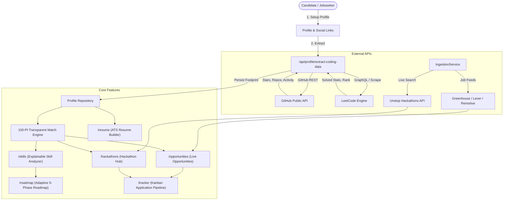

# 🚀 SkillPulse — AI Career & Skill Navigator

[](https://nextjs.org/)
[](https://www.typescriptlang.org/)
[](https://tailwindcss.com/)
[](https://firebase.google.com/)
[](https://github.com/)
[](LICENSE)

> **SkillPulse** is an intelligent, dark-first career enablement platform designed specifically for university students, fresh graduates, and early-career developers. It bridges the gap between candidate portfolios and real-world employer requirements through transparent skill matching, live hackathon ingestion, automated coding footprint extraction, and an ATS-grade resume builder.

---

## 🌟 Highlights & Recent Enhancements

### 🏆 1. Dedicated Hackathon Hub & Unstop Live Ingestion (`/hackathons`)
* **Independent Navigation Route:** Dedicated `/hackathons` route accessible directly from the left sidebar without interfering with the job feed.
* **50+ Live Unstop Competitions:** Directly queries Unstop's public search API for live campus challenges, nationwide hackathons, and corporate innovation sprints.
* **Resilient Direct Registration:** Integrated `getSafeUnstopRegistrationUrl` to map competition slugs to real Unstop event pages, completely resolving previous `unstop.com/page-not-found` (404) routing errors.
* **Specialized Filters:** Filter by participation mode (*Remote*, *On-site*, *Hybrid*), student eligibility (*1st-3rd year*, *all students*, *open to all*), Indian regions (*South India*, *Tamil Nadu*, *Pan-India*), and prize tiers.

### 🧹 2. Cleaned Live Job Descriptions (`/opportunities`)
* **HTML Stripping & Decoding Engine:** Overhauled HTML parsing in `lib/utils.ts` (`stripHtml`) and `base-provider.ts` (`cleanHtml`). Decodes encoded HTML entities (`&lt;h2&gt;`, `&amp;`) before stripping tags.
* **Pristine Job Cards & Modal Typography:** Eliminates unsightly raw HTML strings from Greenhouse (e.g. Stripe, Postman) and Lever listings, rendering clean, formatted descriptions.
* **Transparent 100-Point Match Rubric:** Evaluates role alignment (30 pts), required skills (35 pts), preferred skills (15 pts), work mode (10 pts), and seniority (10 pts).

### 🔗 3. Smart Profile Setup & Mandatory Social Links
* **Mandatory LinkedIn Profile (`*`):** Required field across Onboarding, Quick Setup modal, and Profile Management to guarantee verified candidate identities.
* **Recommended Coding Links:** Clear prompts and guidance to add GitHub and LeetCode profile URLs with format validation.
* **Completion Meter:** Dynamic profile completion algorithm factoring in personal bio, education, skills, projects, and verified web profiles.

### 🤖 4. Automated Developer Intelligence & Coding Footprint Extraction
* **Server-Side Extraction Endpoint (`/api/profile/extract-coding-data`):** Automatically triggers upon profile save or manual refresh.
* **GitHub Activity Analytics:**
  * Public repositories count & total repository stars earned
  * Followers count & top programming languages breakdown
  * Coding and commit activity frequency assessment
* **LeetCode Problem-Solving Analytics:**
  * Total solved count partitioned into *Easy*, *Medium*, and *Hard* tiers
  * Global leaderboard ranking and submission acceptance percentage
* **Admin Candidate Inspector:** Master Admin modal allows recruiters to review live developer footprints and verified profiles in real-time.

---

## 🏗️ Architecture & Data Flow



---

## 📂 Core Project Layout

```
skill_pulse/
├── app/                                    # Next.js App Router
│   ├── (dashboard)/page.tsx                # Root redirect
│   ├── dashboard/page.tsx                  # Metrics & Pipeline Overview
│   ├── hackathons/page.tsx                 # 🏆 Dedicated Unstop Hackathons Hub
│   ├── opportunities/page.tsx              # 💼 Live Job & Internship Explorer
│   ├── saved-opportunities/page.tsx        # 📌 Saved Bookmarks
│   ├── tracker/page.tsx                    # 📊 5-Column Kanban Pipeline
│   ├── profile/page.tsx                    # 👤 Candidate Profile & Developer Footprint
│   ├── onboarding/page.tsx                 # 📝 7-Step Guided Profile Setup
│   ├── skills/page.tsx                     # 🎯 8-Track Skill Gap Diagnostics
│   ├── roadmap/page.tsx                    # 🗺️ Adaptive 5-Phase Milestone Roadmap
│   ├── resume/page.tsx                     # 📄 ATS Resume Builder & PDF Exporter
│   ├── admin/candidates/page.tsx           # 🛡️ Master Admin Candidate Inspector
│   └── api/                                # Serverless API Routes
│       ├── opportunities/route.ts          # Unified Opportunity Ingestion API
│       ├── opportunities/live/route.ts     # Live Ingestion Stream Endpoint
│       └── profile/extract-coding-data/    # 🤖 GitHub & LeetCode Intelligence Extractor
├── components/                             # Shared Components
│   ├── admin/admin-candidate-modal.tsx     # Admin Candidate & Intelligence Inspector
│   ├── layout/sidebar.tsx                  # Platform Navigation & Active Route Handler
│   ├── profile/quick-profile-setup-modal   # Fast-track profile completion modal
│   └── ui/                                 # Accessible UI Component Primitives
├── features/                               # Domain Feature Modules
│   ├── hackathons/hackathons-hub-view.tsx  # Unstop Live Hackathons Interface
│   ├── opportunities/                      # Opportunity Cards, Filters, and Detail Modals
│   ├── dashboard/                          # Readiness Radar, KPI Cards, Spotlights
│   └── onboarding/                         # Guided Onboarding Steps & Social URL Inputs
├── lib/                                    # Business Logic & Infrastructure
│   ├── opportunities/
│   │   ├── hackathons-catalog.ts           # Safe Unstop URL resolution & catalog
│   │   ├── ingestion-service.ts            # Multi-provider aggregator engine
│   │   ├── matching-engine.ts              # Mathematical scoring rubric (0-100)
│   │   └── providers/                      # Greenhouse, Lever, Remotive, Unstop
│   ├── repositories/                       # Decoupled LocalStorage / Firebase Repos
│   └── utils.ts                            # Entity decoding & HTML sanitization
├── types/                                  # Strict Domain Interfaces & Enums
└── scripts/                                # Automated Unit Test Suites
```

---

## ⚡ Quick Start

### 1. Prerequisites
- **Node.js** `v18.x` or `v20.x`+
- **npm** or **pnpm** / **yarn**

### 2. Installation

```bash
# Clone repository
git clone https://github.com/ashwinsiva007/skill_pulse.git
cd skill_pulse

# Install dependencies
npm install
```

### 3. Run Development Server

```bash
npm run dev
```

Visit [http://localhost:3000](http://localhost:3000) to access the platform.

### 4. Running Automated Tests

```bash
# Execute unit test suites (Skill Analyzer + Opportunity Matcher)
npm test
```

### 5. Typecheck & Build

```bash
# Validate strict TypeScript types
npx tsc --noEmit

# Compile production bundle
npm run build
```

---

## 🧪 Testing & Quality Assurance

SkillPulse is backed by 19 unit test suites validating core algorithms:
- **Skill Analyzer Engine (10 Tests):**
  - Token matching & synonym resolution (e.g. Postgres → SQL, React → Next.js)
  - Numerical proficiency scaling (0 to 4 scale)
  - Edge cases (zero recorded skills, zero denominator protection)
  - Portfolio project evidence weighting
  - Adaptive roadmap milestone generation
- **Opportunity Matcher Engine (9 Tests):**
  - Role & domain alignment scoring (30 pts exact, 25 pts domain)
  - Partitioning required vs. preferred competencies
  - Work mode alignment (Remote, Hybrid, On-site)
  - Clamping match scores cleanly between `[0, 100]` with educational disclaimers
  - Catalogue integrity across all starter opportunities

---

## 🛡️ License

This project is licensed under the [MIT License](LICENSE).
